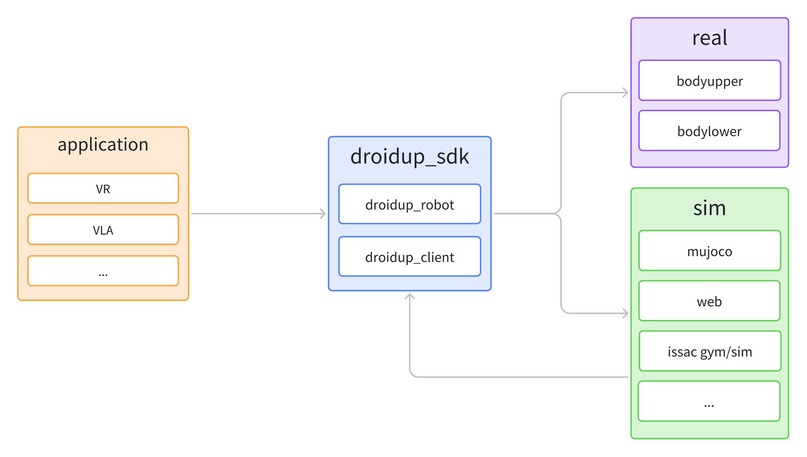

# 介绍

## droidup mujoco
`droidup_mujoco` 是基于 `droidup_sdk` 和 `mujoco` 开发的仿真平台。用户使用 `droidup_sdk`开发的控制程序可以方便地接入该仿真平台，可以很方便地实现仿真到实物的开发流程。其结构大致如下图所示:



## 目录结构
- `assets`: droidup_sdk 支持的机器人 mjcf 描述文件
- `simulate`: 基于 droidup_sdk 和 mujoco (python) 实现的仿真平台
- `test`: 测试程序
- `example`: 例程

## 支持的 droidup sdk 层级：

**当前版本仅支持底层开发，主要用于控制器的 sim to real 验证**

- `droidup-client`: 关节控制指令，IMU数据

## 相关链接
- [droidup_sdk](https://github.com/vipdroid/droidup-sdk)
- [mujoco doc](https://mujoco.readthedocs.io/en/stable/overview.html)

# 安装

## Python 仿真 (simulate)

### 1. 依赖

#### droidup_sdk

从[droidup_sdk](https://github.com/vipdroid/droidup-sdk)发布页下载文件

```bash
conda create -n droidup_mujoco python=3.10
conda activate droidup_mujoco
pip install droidup_api-1.0.0-py3-none-any.whl
pip install droidup_client-1.0.0-py3-none-any.whl
```

#### mujoco-python
```bash
pip install mujoco
pip install mujoco-python-viewer
```

#### requirement
```bash
pip install tqdm
```

### 2. 测试
```bash
python ./simulate/droidup_mujoco.py
```
在新终端运行
```bash
python ./test/leg_base_test.py
python ./test/arm_base_test.py
```
程序会控制机器人位置变化


# 使用

## 1. 仿真配置

### python 仿真

python 仿真的配置文件位于 `/simulate/configs` 文件夹中：


## 2. sim to real

`example` 文件夹下提供了使用相同的接口连接仿真和实物的代码。这些例子简演示了如何使用 droidup 提供的接口实现仿真到实物的实现，只需要修改连接机器人的IP。
